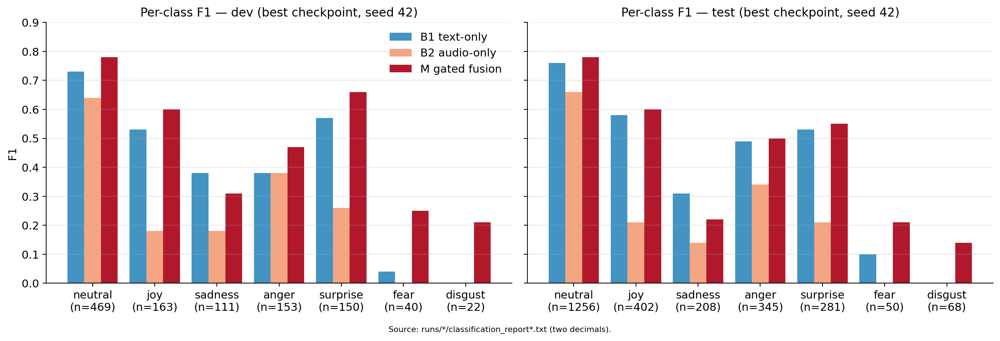
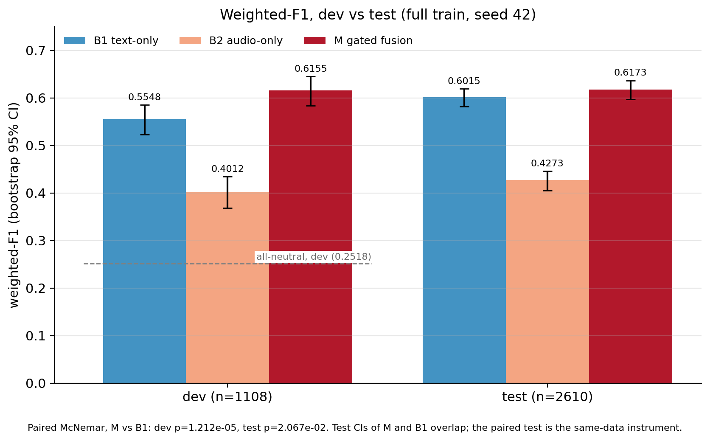
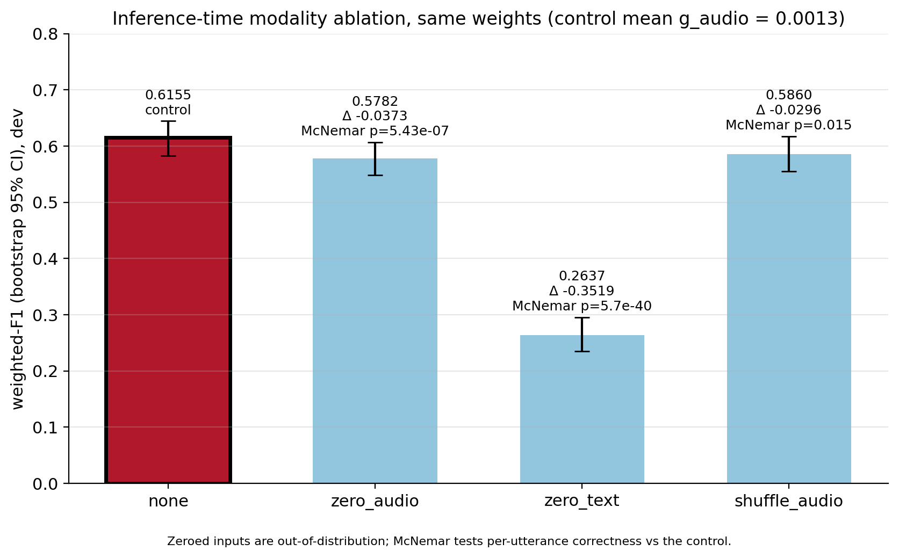
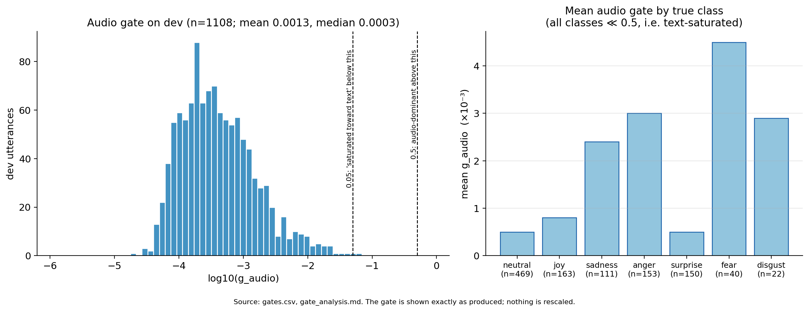

# emorec-xmm

Explainable multimodal (text + audio) emotion recognition on the MELD dialogue
dataset: a gated cross-attention fusion model over frozen RoBERTa (text) and
WavLM (audio) encoders, evaluated against text-only and audio-only baselines,
with an Integrated Gradients, modality-ablation and gate-analysis explainability
study.

**Status:** complete for the final review. One full-train run per model (seed 42)
has been trained and evaluated on the official MELD dev and test splits, and the
explainability study has been run on the fusion model. The full write-up is in
**[docs/FINAL_REPORT.md](docs/FINAL_REPORT.md)**; every number there and below is
traced to a file under `results/`.

## Headline results

Full train split, seed 42, one run per model. Bootstrap 95% CI (1,000 utterance
resamples) in brackets. Source: `results/reports/statistics.md`,
`results/reports/final_results.md`.

| model | dev weighted-F1 | dev macro-F1 | test weighted-F1 | test macro-F1 | test accuracy |
|---|---|---|---|---|---|
| all-neutral baseline | 0.2518 | 0.0850 | – | – | 0.4812 |
| B1 text-only | 0.5548 [0.5230, 0.5855] | 0.3760 [0.3500, 0.4021] | 0.6015 [0.5815, 0.6193] | 0.3948 [0.3734, 0.4151] | 0.6199 [0.6008, 0.6372] |
| B2 audio-only | 0.4012 [0.3687, 0.4342] | 0.2339 [0.2103, 0.2576] | 0.4273 [0.4052, 0.4457] | 0.2222 [0.2063, 0.2357] | 0.4797 [0.4594, 0.4966] |
| **M gated fusion** | **0.6155** [0.5832, 0.6448] | **0.4670** [0.4251, 0.5057] | **0.6173** [0.5973, 0.6367] | **0.4276** [0.4003, 0.4534] | **0.6387** [0.6195, 0.6559] |

- Dev n = 1,108 (one dev utterance has no media file); test n = 2,610. "–": not computed.
  The all-neutral test accuracy is the neutral share of the test set (48.12%).
- M beats B1 by +0.0607 weighted-F1 on dev and +0.0158 on test. On test the two weighted-F1 CIs
  **overlap**, yet the paired exact McNemar test is **significant** (p = 0.021; dev p = 1.2e-05). The paired test is the
  right instrument for two models scored on the same utterances; the small test effect should still be read as small.
  The dev gain is probably inflated by choosing the checkpoint on dev (report §5.3); the test figure is the held-out one.
- The largest gains are on the rare classes (test fear F1 0.10 → 0.21, disgust 0.00 → 0.14). Fusion **regresses on
  sadness** (dev 0.38 → 0.31, test 0.31 → 0.22). See the per-class analysis in the report.
- One seed only: there is no seed-to-seed variance in these numbers.

### Explainability finding

The learned modality gate is **text-saturated**: mean g_audio = 0.0013 on dev and 99.91% of utterances below 0.05
(none audio-dominant). Read alone it says the model ignores audio, but a modality ablation on the same weights shows
otherwise: zeroing the audio lowers weighted-F1 by 0.0373 (McNemar p = 5.43e-07), and pairing each utterance with another
utterance's audio lowers it by 0.0296 (p = 0.015), so the audio is used and its content matters; removing the text
costs 0.3519 (p = 5.7e-40). The gate is applied after the cross-modal blocks, so audio information has already entered the
text stream when the gate weights the pooled audio summary: **the gate is a measured failure of an intrinsic signal to
reflect information flow**, and the ablation is what exposes it. Integrated Gradients is faithful by deletion curves
(it beats a random-attribution control on all four comprehensiveness/sufficiency curves, with paired CIs excluding zero)
and passes a head-randomisation sanity check, though its mean |convergence delta| is 0.284, so individual token scores
should not be over-interpreted. Details, caveats and the scope of the mechanism claim: `docs/FINAL_REPORT.md` §7.

## Figures

Regenerate with `python scripts/make_final_figures.py --results-dir results` (reads only committed artifacts).

| per-class F1 (dev, test) | weighted-F1 dev vs test with CIs |
|---|---|
|  |  |

| modality ablation | audio-gate distribution |
|---|---|
|  |  |

IG faithfulness curves: `results/reports/figures/faithfulness_curves.png`; per-example IG token heatmaps and audio
timelines: `results/reports/figures/dev_*_tokens.png` / `dev_*_audio.png`; list with scores: `results/reports/xai_examples.md`.

## Install

```bash
pip install -e ".[dev,xai]"     # drop ",xai" if you do not need Integrated Gradients (captum)
```

## Test

```bash
pytest -q
ruff check src tests scripts
```

The suite is offline: it needs no MELD data, no GPU and no pretrained checkpoints.

## Reproduce

MELD is not bundled. Point the tools at the raw MELD mirror via `--meld-root`, the `MELD_ROOT` environment variable,
or `data.meld_root` in `configs/base.yaml` (the mirror layout is discovered at runtime). Everything heavy is written under
`artifacts/` (gitignored); `results/` is a committed copy of the outputs behind this report.

```bash
# 1. Data: validate metadata + media, extract 16 kHz WAVs, write manifests
python scripts/inspect_meld.py --meld-root "$MELD_ROOT"
python scripts/prepare_data.py --stage full --split all --meld-root "$MELD_ROOT"

# 2. Audio feature cache (once per encoder checkpoint)
for s in train dev test; do
  python scripts/build_cache.py --manifest artifacts/manifests/$s.jsonl --config configs/base.yaml
done

# 3. Train B1 / B2 / M (seed 42, at most 10 epochs, best-dev checkpoint kept)
for m in text_only audio_only xattn; do
  python scripts/train.py --config configs/$m.yaml \
      --train-manifest artifacts/manifests/train.jsonl --dev-manifest artifacts/manifests/dev.jsonl \
      --seed 42 --epochs 10 --device auto
done

# 4. Evaluate a checkpoint (test is refused unless --allow-test) and summarise runs
python scripts/evaluate.py --ckpt artifacts/runs/<run>/best.pt --config configs/<model>.yaml \
    --manifest artifacts/manifests/dev.jsonl --split dev
python scripts/summarize_runs.py

# 5. Explainability on the fusion model
python scripts/run_xai.py          --ckpt artifacts/runs/<xattn-run>/best.pt --config configs/xattn.yaml
python scripts/run_ablation.py     --ckpt artifacts/runs/<xattn-run>/best.pt --config configs/xattn.yaml
python scripts/run_faithfulness.py --ckpt artifacts/runs/<xattn-run>/best.pt --config configs/xattn.yaml \
    --n-examples 40 --n-steps 64

# 6. Figures
python scripts/make_final_figures.py --results-dir results
```

The full command sequence, including the test evaluation and the snippet that reproduces the bootstrap CIs and
McNemar tests from the saved predictions, is in `docs/FINAL_REPORT.md` §9.

## Not implemented

Multiple seeds and seed-variance statistics, the concat baseline (B3) run (code and tests exist), LoRA / Stage 2,
occlusion and attention attribution, the Gemini benchmark, ONNX export and the Gradio demo. See
`docs/KNOWN_LIMITATIONS.md` for the status of every pre-registered limitation.

## Documentation

`docs/FINAL_REPORT.md` (results and analysis) · `docs/ARCHITECTURE.md` and `docs/DECISIONS.md` (frozen design) ·
`docs/EVALUATION.md` (metrics and statistics protocol) · `docs/KNOWN_LIMITATIONS.md` (limitations with evidence) ·
`docs/CLAUDE_CODE_HANDOFF.md` (engineering state).
