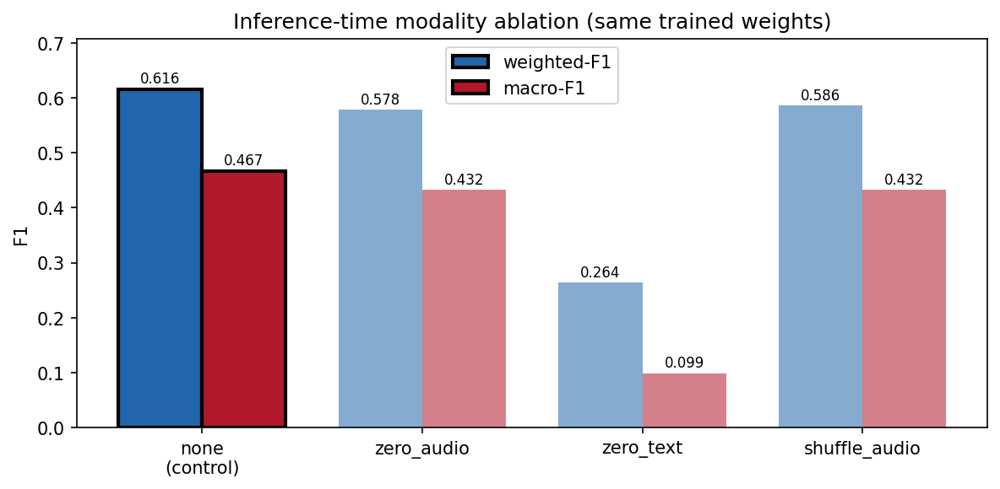

# Modality ablation

- checkpoint: `artifacts/runs/xattn-seed42-20261006T070547Z/best.pt`  |  config: `configs/xattn.yaml`  |  manifest: `artifacts/manifests/dev.jsonl`  |  n = 1108
- seed: 42  |  generated (UTC): 2026-10-06 09:15:06Z
- Same trained weights in every row; only the inference-time input is changed (`emorec.xai.ablation`). `none` is the control. The gate is never rescaled.

## Results

| mode | accuracy | macro-F1 | weighted-F1 [95% CI] | ΔwF1 | Δmacro | mean g_audio |
|---|---|---|---|---|---|---|
| none | 0.6363 | 0.4670 | 0.6155 [0.5832, 0.6448] | +0.0000 | +0.0000 | 0.0013 |
| zero_audio | 0.5848 | 0.4325 | 0.5782 [0.5480, 0.6069] | -0.0373 | -0.0345 | 0.0017 |
| zero_text | 0.4097 | 0.0991 | 0.2637 [0.2348, 0.2957] | -0.3519 | -0.3679 | 0.0001 |
| shuffle_audio | 0.6119 | 0.4324 | 0.5860 [0.5551, 0.6177] | -0.0296 | -0.0345 | 0.0010 |

## Paired McNemar (correctness), `none` vs each ablation

n01 = control right & ablated wrong; n10 = control wrong & ablated right.

| ablation | n01 | n10 | discordant | p (exact, two-sided) |
|---|---|---|---|---|
| zero_audio | 93 | 36 | 129 | 5.43e-07 |
| zero_text | 319 | 68 | 387 | 5.7e-40 |
| shuffle_audio | 71 | 44 | 115 | 0.015 |

## Per-class F1

| mode | neutral | joy | sadness | anger | surprise | fear | disgust |
|---|---|---|---|---|---|---|---|
| none | 0.7779 | 0.5960 | 0.3077 | 0.4739 | 0.6598 | 0.2466 | 0.2069 |
| zero_audio | 0.7619 | 0.5542 | 0.2727 | 0.3951 | 0.5869 | 0.2344 | 0.2222 |
| zero_text | 0.5976 | 0.0000 | 0.0000 | 0.0745 | 0.0000 | 0.0000 | 0.0213 |
| shuffle_audio | 0.7543 | 0.5964 | 0.2597 | 0.4214 | 0.6361 | 0.0923 | 0.2667 |

## Interpretation

On 1108 utterances the unmodified model scores weighted-F1 0.6155 (macro-F1 0.4670) with mean g_audio = 0.0013. Replacing the audio with zeros changes weighted-F1 by -0.0373 and macro-F1 by -0.0345; McNemar on correctness, none vs zero_audio: n01=93, n10=36, p=5.43e-07, statistically significant (p < 0.05). Replacing the text with pad embeddings changes weighted-F1 by -0.3519 and macro-F1 by -0.3679; McNemar on correctness, none vs zero_text: n01=319, n10=68, p=5.7e-40, statistically significant (p < 0.05). Pairing each utterance with another utterance's audio changes weighted-F1 by -0.0296 and macro-F1 by -0.0345; McNemar on correctness, none vs shuffle_audio: n01=71, n10=44, p=0.015, statistically significant (p < 0.05). Removing audio significantly lowers accuracy, so the audio stream is used by the model even though the gate weights the pooled audio summary at 0.0013. Mismatched audio also hurts significantly, which is consistent with the model using utterance-specific audio content and not merely the presence of an audio stream. These are inference-time interventions on a model trained with real audio and text: zeroed inputs are out-of-distribution, so the size of a drop measures reliance on that stream under the intervention.

