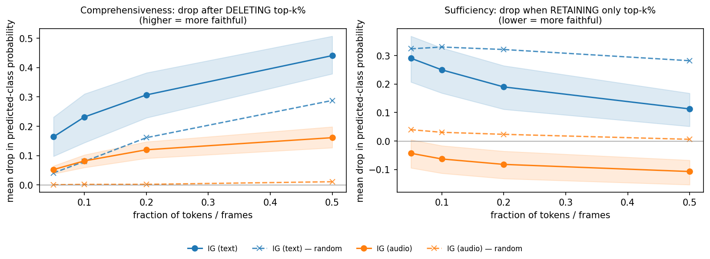

# Faithfulness of IG attributions

- checkpoint: `artifacts/runs/xattn-seed42-20261006T070547Z/best.pt`  |  config: `configs/xattn.yaml`  |  manifest: `artifacts/manifests/dev.jsonl`
- 40 class-stratified examples (seed 42)  |  IG n_steps=64  |  generated (UTC): 2026-10-06 09:17:20Z
- fractions: 0.05, 0.1, 0.2, 0.5. Curves are the mean DROP in predicted-class probability; AUC is the unnormalised trapezoid area over those fractions.
- comprehensiveness: DELETE the top-k% attributed positions (higher = more faithful). sufficiency: RETAIN only the top-k% (the drop from the full input; lower = more faithful).
- Deletion operators match the IG baselines by construction (pad embedding for text, zero pre-`proj_a` frame for audio), which mildly favours IG (docs/KNOWN_LIMITATIONS.md 14). Positions are ranked by signed attribution; all real tokens (including structural ones) and real frames are eligible.
- Random control: mean of 5 seeded random attributions per example.
- IG convergence: mean |delta| = 2.841e-01; 0 of 80 IG passes were re-run at 64 steps (re-runs only happen when --n-steps < 64).

## AUC (mean over examples, 95% bootstrap CI)

| modality | curve | IG AUC [CI] | random AUC [CI] | IG − random [CI] | IG better than random? |
|---|---|---|---|---|---|
| text | comprehensiveness | 0.1490 [0.1184, 0.1779] | 0.0825 [0.0651, 0.0987] | +0.0665 [+0.0451, +0.0889] | yes |
| text | sufficiency | 0.0809 [0.0496, 0.1100] | 0.1394 [0.1104, 0.1678] | -0.0585 [-0.0815, -0.0359] | yes |
| audio | comprehensiveness | 0.0556 [0.0430, 0.0680] | 0.0023 [-0.0031, 0.0073] | +0.0534 [+0.0409, +0.0640] | yes |
| audio | sufficiency | -0.0383 [-0.0604, -0.0189] | 0.0089 [-0.0067, 0.0229] | -0.0472 [-0.0584, -0.0364] | yes |

`IG better than random` is `yes` when the paired (per-example) CI of IG − random excludes 0 in the faithful direction (positive for comprehensiveness, negative for sufficiency); otherwise the result is reported as no significant difference from chance.

## Parameter-randomisation sanity check (Adebayo-style, classifier head)

Re-initialised `model.mlp` on a copy (the real model is never modified), IG recomputed for the same target, Spearman correlation with the original attributions per example (20 examples). A method is reported BROKEN for this model if the mean signed Spearman stays >= 0.5.

| modality | n | mean Spearman (signed) | mean Spearman (magnitudes) | verdict |
|---|---|---|---|---|
| text | 20 | -0.1432 | 0.2944 | attributions degrade |
| audio | 20 | -0.0798 | 0.3272 | attributions degrade |

Dashed lines: random-attribution control.
